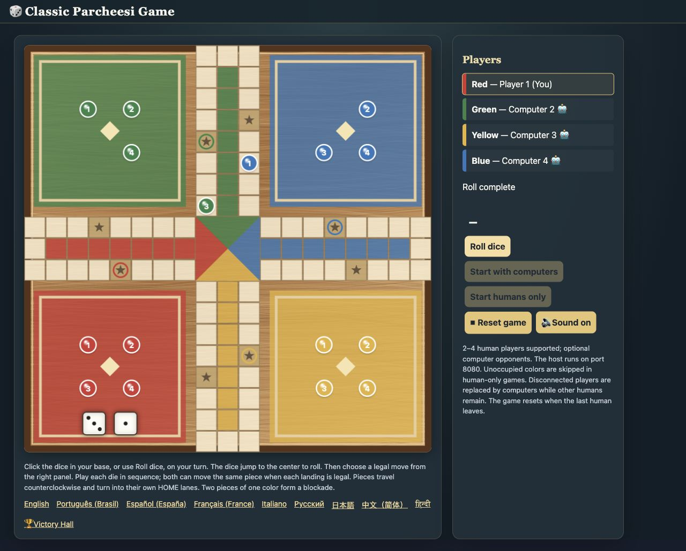

# Classic Parcheesi Game

A classic Parcheesi board game for **2–4 players on the same network**, with optional computer opponents. Run one server on Ubuntu Linux and join from desktop, tablet, or phone browsers. No client installation is needed.



## Features

- Wooden board, numbered pieces, hopping moves, and dice that jump from the active player's base to the center to roll.
- Server-validated movement, captures, safety spaces, blockades, home lanes, bonuses, and doubles.
- Human-only games or computer opponents for open seats.
- Fixed mobile turn controls: roll and move without scrolling below the board.
- Optional lobby music, game sounds, and a winner celebration with fireworks.
- Victory Hall ranked by wins. Ubuntu installations keep scores in RAM across game resets and service restarts; rebooting the machine clears them.
- Rules in English, Brazilian Portuguese, Spanish, French, Italian, Russian, Japanese, Simplified Chinese, and Hindi.
- Automatic return to the lobby when the last human disconnects.

## Download and install on Ubuntu Linux

Requires Ubuntu/Debian with **systemd**, an internet connection for installing Python dependencies, and a user with `sudo` access. The installer creates a dedicated service user, installs to `/opt/pachisi-lan`, and starts the game automatically after boot.

[Download the latest game package](https://github.com/N4EAC/classic-parcheesi-game/releases/latest/download/classic-parcheesi-game.tar.gz) · [All releases](https://github.com/N4EAC/classic-parcheesi-game/releases)

Run these commands on the Ubuntu computer:

```bash
sudo apt update
sudo apt install -y curl

curl -fLO https://github.com/N4EAC/classic-parcheesi-game/releases/latest/download/classic-parcheesi-game.tar.gz
curl -fLO https://github.com/N4EAC/classic-parcheesi-game/releases/latest/download/classic-parcheesi-game.tar.gz.sha256
sha256sum -c classic-parcheesi-game.tar.gz.sha256

tar -xzf classic-parcheesi-game.tar.gz
cd classic-parcheesi-game
sudo bash install-pachisi.sh
```

Open **http://localhost:8080** on the server. To join from another device on the same LAN, find the server's IP:

```bash
hostname -I
```

Open `http://SERVER_IP:8080` on each device, replacing `SERVER_IP` with the Ubuntu computer's LAN address. Join with a nickname, then choose **Start with computers** or **Start humans only**. Use the same nickname in later games to accumulate Victory Hall wins.

If UFW is active, the installer allows TCP port 8080. The game is designed for a trusted LAN and does not require player accounts.

### Install from source instead

```bash
sudo apt update
sudo apt install -y git
git clone https://github.com/N4EAC/classic-parcheesi-game.git
cd classic-parcheesi-game
sudo bash install-pachisi.sh
```

You can also download the [source ZIP](https://github.com/N4EAC/classic-parcheesi-game/archive/refs/heads/main.zip), extract it, and run `sudo bash install-pachisi.sh` from the extracted directory.

### Service commands

```bash
sudo systemctl status pachisi-lan --no-pager
sudo systemctl restart pachisi-lan
sudo systemctl stop pachisi-lan
sudo journalctl -u pachisi-lan -f
```

The service name is `pachisi-lan`. Logs are available in the systemd journal.

### Update an existing installation

Download and extract the latest package again, then rerun:

```bash
sudo bash install-pachisi.sh
```

Updating restarts the game service and ends the current match. Victory Hall scores remain in the preserved RAM runtime directory until the machine reboots. Refresh existing browser tabs after updating.

### Copy a download over SSH

Download the package to another computer, then copy it to Ubuntu:

```bash
scp classic-parcheesi-game.tar.gz USER@SERVER_IP:~/
ssh USER@SERVER_IP
```

In the SSH session:

```bash
mkdir -p ~/classic-parcheesi-install
tar -xzf ~/classic-parcheesi-game.tar.gz -C ~/classic-parcheesi-install
cd ~/classic-parcheesi-install/classic-parcheesi-game
sudo bash install-pachisi.sh
```

Ubuntu needs an SSH server for this method. If necessary, run `sudo apt install openssh-server` and `sudo systemctl enable --now ssh` directly on Ubuntu first.

## How to play

1. Join with a nickname. Two or more humans can play, or fill open seats with computers.
2. The highest opening dice total starts.
3. Click the dice in your base or **Roll dice**. Choose a legal move; on mobile use the move selector and **Move piece**.
4. Bring all four pieces HOME to win. Open **Victory Hall** below the board to see the leaderboard.

**Lobby music** is off by default. Check its small checkbox to play music while players join; starting the game stops it. The Sound switch controls music and effects. Reduced-motion preferences are respected.

If a player disconnects while other humans remain, a computer takes over. When the last human leaves, the match resets. Refreshing the only human player's browser therefore resets that match. Rejoining an ongoing game with other humans does not reclaim the disconnected seat.

## Run without installing a system service

Requires Python 3.10 or newer:

```bash
python3 -m venv .venv
. .venv/bin/activate
python -m pip install -r pachisi-lan/requirements.txt
python pachisi-lan/server.py
```

Open **http://localhost:8080**. Direct development launches keep Victory Hall only in process memory unless `PARCHEESI_HALL_FILE` is configured. The Ubuntu installer sets this to `/run/pachisi-lan/victory-hall.json` and preserves the runtime directory across service restarts.

## Tests

With the Python environment above activated:

```bash
cd pachisi-lan
python -m unittest -v
```

Optional frontend checks require Node.js, with no npm dependencies:

```bash
node test_frontend.cjs
```

The suite covers rules, 20 complete seeded games, multiplayer synchronization, abandonment recovery, audio routes, all nine rules pages, Victory Hall counting and retention, and frontend movement/audio/dice behavior. HTTP tests bind temporary localhost ports.

## Music and credits

**“Signal to Noise” by Scott Buckley**, released under **CC BY 4.0**. [Track and attribution information](https://www.scottbuckley.com.au/library/signal-to-noise/) · [License](https://creativecommons.org/licenses/by/4.0/) · [YouTube](https://www.youtube.com/@ScottBuckley).

See [CREDITS.md](CREDITS.md) for asset details and [the gameplay notes](pachisi-lan/README.md) for more implementation information.
